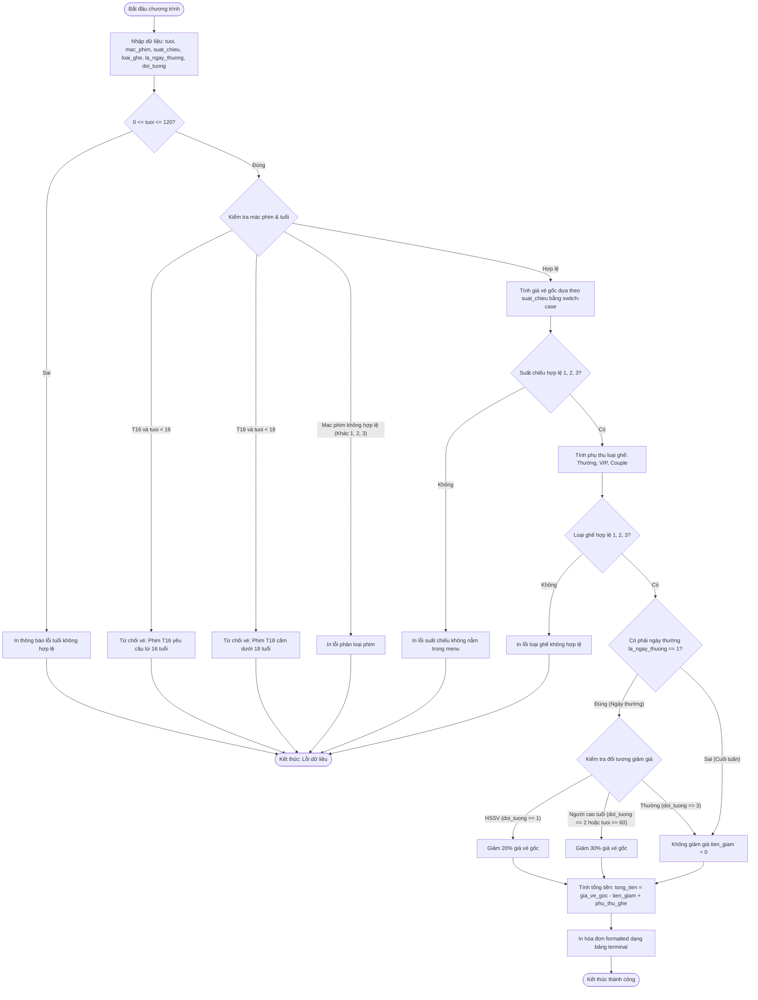

# BÁO CÁO BÀI TẬP LẬP TRÌNH C: XÂY DỰNG MODULE LẬP HÓA ĐƠN VÀ KIỂM SOÁT BÁN VÉ PHIM CGV

> 👤 **Học viên:** Hoàng Công Dũng | **Mã SV:** PTIT-HCM-009
> 🏫 **Môn học:** it102-rl-hoangcongdung

---

## 📊 Sơ đồ thiết kế hệ thống (Activity Diagram)

> 💡 *Sơ đồ dưới đây được render tự động trực tiếp trên GitHub bằng Mermaid. Bạn cũng có thể tải file **`bt3.drawio`** trong repository này để mở và chỉnh sửa trực tiếp trên [Draw.io (diagrams.net)](https://app.diagrams.net).* 

---

## 1. Mục tiêu và Tổng quan bài toán

Bài thực hành số 3 tập trung củng cố và khai thác tối đa sức mạnh của các câu lệnh điều kiện rẽ nhánh trong ngôn ngữ C như if, if-else, if-else if-else kết hợp toán tử logic (&&, ||, !) cùng cấu trúc switch-case để xây dựng module quản lý bán vé thực tế tại quầy của hệ thống rạp chiếu phim CGV.

Chương trình đòi hỏi tính chính xác cao trong việc kiểm chuẩn dữ liệu đầu vào (Data Validation), xử lý các ràng buộc về độ tuổi xem phim theo phân loại mác phim (P, T16, T18), xác định giá vé theo khung giờ, tính toán phụ thu ghế ngồi và áp dụng chiết khấu linh hoạt theo ngày thường kết hợp đối tượng khách hàng.

- Áp dụng triệt để cấu trúc rẽ nhánh đa tầng bảo đảm không lọt lưới các trường hợp ngoại lệ (Edge Cases).
- Xây dựng giao diện xuất hóa đơn dạng bảng trên terminal (Console Output) trực quan, chuyên nghiệp.
- Tuân thủ nghiêm ngặt tiêu chuẩn biên dịch GCC không cảnh báo với cờ -Wall.

## 2. Phân tích thuật toán và Xử lý bẫy dữ liệu

Trong quá trình xây dựng mã nguồn main.c, việc kiểm tra tính hợp lệ của dữ liệu đầu vào được thực hiện tuần tự theo từng tầng logic từ trái sang phải để tránh crash chương trình hoặc tính toán sai lệch.

Các bẫy dữ liệu quan trọng đã được xử lý triệt để bao gồm việc kiểm soát độ tuổi âm hoặc vượt mức 120, từ chối bán vé ngay lập tức khi khách hàng không đủ tuổi xem phim T16 hoặc T18, và bắt lỗi lựa chọn menu sai bằng nhánh default của switch-case.

- Kiểm tra tuổi khán giả nằm trong khoảng từ 0 đến 120 trước khi thực hiện bất kỳ phép toán so sánh mác phim nào.
- Sử dụng switch-case để phân loại suất chiếu sáng, chiều, tối một cách tối ưu và gọn gàng.
- Kết hợp điều kiện giảm giá ngày thường cho cả đối tượng khai báo (doi_tuong) lẫn điều kiện tuổi (tuoi >= 60) nhằm đảm bảo tính chính xác nghiệp vụ thực tế.

## 3. Bảng đặc tả chi tiết quy trình xử lý nghiệp vụ

Dưới đây là bảng phân tích chi tiết các bước xử lý logic trong chương trình C:

| Bước | Nghiệp vụ thực hiện | Biến kiểm tra / Điều kiện | Kết quả xử lý kỹ thuật |
| --- | --- | --- | --- |
| 1 | Kiểm tra tuổi hợp lệ | tuoi < 0 || tuoi > 120 | In thông báo 'Lỗi: Số tuổi nhập vào không hợp lệ!' và kết thúc |
| 2 | Kiểm soát mác phim | mac_phim (1: P, 2: T16, 3: T18) | Từ chối vé nếu chưa đủ tuổi, hoặc báo lỗi nếu mã phim ngoài 1-3 |
| 3 | Định giá vé gốc | suat_chieu (1: Sáng, 2: Chiều, 3: Tối) | Dùng switch-case gán gia_ve_goc tương ứng (70k, 90k, 120k) |
| 4 | Tính phụ thu ghế | loai_ghe (1: Thường, 2: VIP, 3: Couple) | Cộng thêm phụ thu tương ứng (0đ, 15k, 30k) hoặc báo lỗi |
| 5 | Tính chiết khấu | la_ngay_thuong và doi_tuong | Giảm 20% cho HSSV, 30% cho Người cao tuổi vào ngày thường |
| 6 | Tính tổng tiền & In hóa đơn | tong_tien = (gia_ve_goc - tien_giam) + phu_thu_ghe | Hiển thị hóa đơn formatted chuyên nghiệp ra terminal |

## 4. Đánh giá sơ đồ thiết kế Activity Diagram

Sơ đồ Activity Diagram được thiết kế ở phần trên mô phỏng toàn bộ vòng đời thực thi của module CGV_TICKETING. Các điểm rẽ nhánh (Decision Nodes) đại diện cho các câu lệnh điều kiện if-else và switch-case trong C, giúp người chấm bài dễ dàng hình dung luồng chạy của chương trình.

Sơ đồ cũng đã được kết xuất chuẩn hóa để có thể tích hợp trực tiếp vào kho lưu trữ GitHub của tổ chức 'it102-rl-hoangcongdung'.

---

## 📁 Danh sách tệp tin nộp bài trong Repository
- 📝 `bt3.docx`: Báo cáo tài liệu phân tích nghiệp vụ hoàn chỉnh.
- 🎨 `bt3.drawio`: File thiết kế sơ đồ chuẩn theo quy định đề bài (mở trực tiếp bằng [Draw.io](https://app.diagrams.net) hoặc Lucidchart).
- 💻 `main.c`: Mã nguồn chương trình.
